# Sentinel SOC Home Lab

<!-- WALKTHROUGH VIDEO: after Day 13, replace this comment with the line below (unlisted YouTube link)
**▶ [5-minute walkthrough video](YOUTUBE_LINK)**
-->

## Summary

A working SOC lab in Microsoft Azure. A Windows 11 VM with Sysmon sends its Windows Security and Sysmon logs to Microsoft Sentinel through the Azure Monitor Agent. I verified ingestion, hunted with KQL, and traced commands I ran on the VM back through the SIEM using the logs alone.

**Stack:** Microsoft Sentinel · Log Analytics · Azure Monitor Agent · Data Collection Rules · Sysmon · KQL · Windows 11 · Azure networking (NSG)
**Status:** Log pipeline live and verified. The brute-force analytics rule and incident are next (see [What I'd do next](#what-id-do-next)).

## Why I built it

Tier 1 SOC work comes down to three things: getting the right logs into a SIEM, querying them, and proving what happened on a machine without being on it. I built this lab to practice all three hands-on in Microsoft Sentinel, which many SOCs run. I didn't want to only read about it.

## Architecture

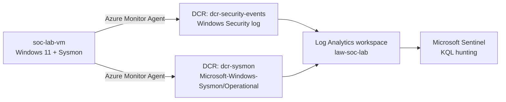

| Component | Name | Purpose |
|---|---|---|
| Resource group | `rg-soc-lab` | Holds everything, so the lab can be deleted in one step |
| Log Analytics workspace | `law-soc-lab` | Where the logs are stored |
| Microsoft Sentinel | on `law-soc-lab` | SIEM layer for hunting, detections and incidents |
| Virtual machine | `soc-lab-vm` (Windows 11 Pro, East US) | The endpoint being monitored |
| Sysmon | SwiftOnSecurity config | Detailed process, network, registry and DNS logging |
| Data collection rules | `dcr-security-events`, `dcr-sysmon` | Send each log source to the workspace |

## What I did

1. **Stood up the SIEM.** I created the resource group `rg-soc-lab` and the Log Analytics workspace `law-soc-lab`, then enabled Microsoft Sentinel on it.
2. **Built the endpoint.** I deployed `soc-lab-vm` (Windows 11 Pro, East US). Azure's default rules blocked RDP, so I added an allow rule for port 3389 from **my IP only**, not the whole internet.
3. **Turned on detailed logging.** I installed Sysmon with the SwiftOnSecurity config to record process creation, network connections, registry changes and DNS queries.
4. **Connected the logs.** I installed the Windows Security Events and Windows Forwarded Events solutions and created two data collection rules. One collects Windows Security events. The other collects Sysmon with the XPath `Microsoft-Windows-Sysmon/Operational!*`.
5. **Verified and hunted.** I confirmed both log sources in KQL, checked failed logons, reviewed process creation, then generated activity on the VM (`whoami`, `ipconfig /all`) and found it in Sentinel.

## Evidence

All screenshots are in [`screenshots/`](screenshots/). Subscription IDs, tenant IDs and public IPs are cropped or blurred.

| Lab checkpoint | Evidence |
|---|---|
| Sysmon installed, `Get-Service Sysmon64` shows Running | [01](screenshots/01-sysmon-installed-running.jpg): Sysmon v15.22 installed, config (schema 4.50) validated, Sysmon64 and SysmonDrv started |
| Sysmon Operational log has events | [10](screenshots/10-event-viewer-sysmon-operational.jpg): Event Viewer on the VM shows 178 Sysmon events (process creation, registry, DNS, file creation, network) |
| RDP restricted to my IP | [11](screenshots/11-nsg-before-no-rdp-rule.jpg) (before: no RDP rule, DenyAllInBound blocks 3389), [12](screenshots/12-rdp-port-3389-accessible.jpg) (after: port 3389 reachable from my IP) |
| `SecurityEvent` query returns rows | [07](screenshots/07-security-events-by-id-first-check.jpg) (first check: 10 event types), [08](screenshots/08-security-events-by-id.jpg) (later: 19 event types) |
| Sysmon `WindowsEvent` query returns rows | [03](screenshots/03-sysmon-events-in-sentinel.jpg), [04](screenshots/04-sysmon-event-detail.jpg), [05](screenshots/05-sysmon-events-by-id.jpg) |
| First detections run | [06](screenshots/06-sysmon-process-creation-id1.jpg) (process creation), [09](screenshots/09-failed-logons-4625.jpg) (failed logons) |
| Generated my own activity on the VM | [02](screenshots/02-test-activity-whoami-ipconfig.jpg), [02b](screenshots/02b-test-activity-whoami.jpg), [02c](screenshots/02c-test-activity-ipconfig.jpg): `whoami` and `ipconfig /all` run as `soc-lab-vm\icd.23` |
| Found my own activity in Sentinel | [13](screenshots/13-traced-test-commands-in-sentinel.jpg): Sysmon process-creation events for `ipconfig.exe /all` and `whoami.exe` run by `soc-lab-vm\ICD.23` |

### Sysmon installed and running on the VM
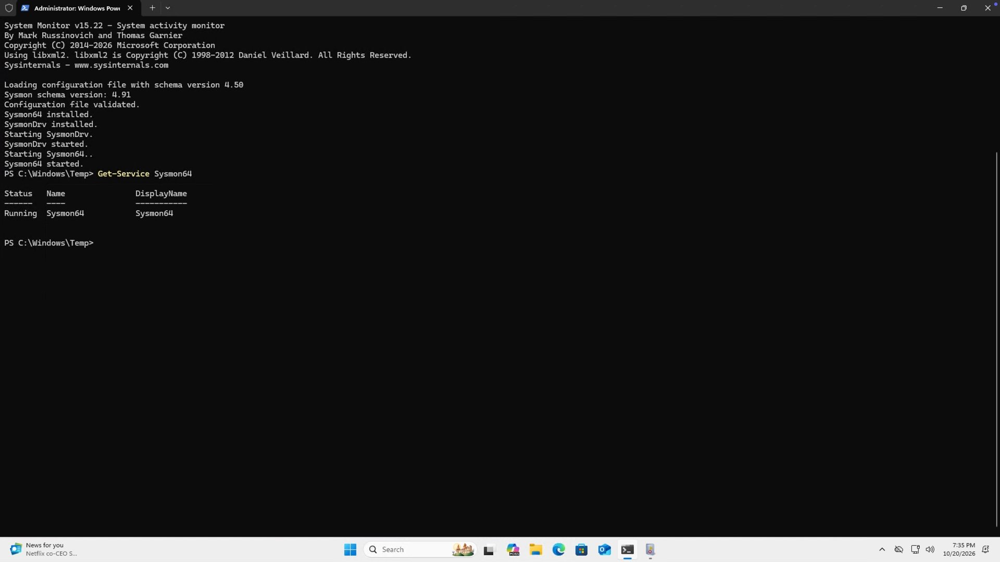

### Locking down RDP (troubleshooting)
The VM was deployed without an inbound RDP rule, so Azure's default `DenyAllInBound` (priority 65500) blocked port 3389.

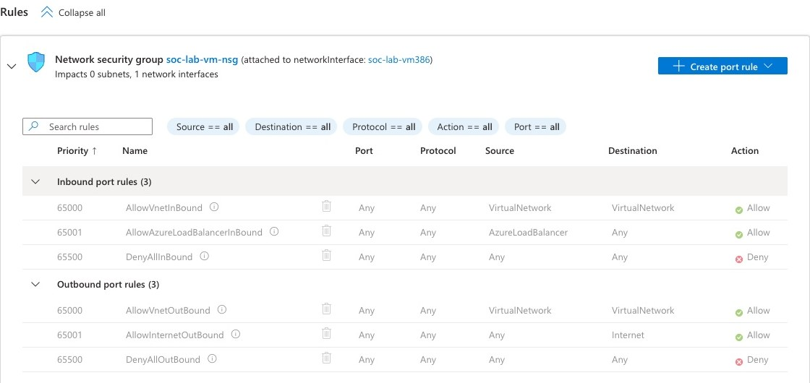

I added an allow rule for RDP (TCP 3389) at priority 300 with the source set to my own public IP only. Azure's connection check then confirmed access. IP addresses are blurred.

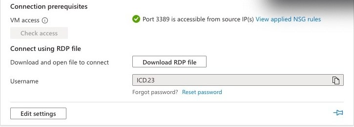

### Sysmon logging on the VM
Event Viewer → Applications and Services Logs → Microsoft → Windows → Sysmon → Operational shows 178 events. They include process creation (ID 1), registry value set (13), DNS queries (22), file creation (11), network connections (3) and process termination (5).

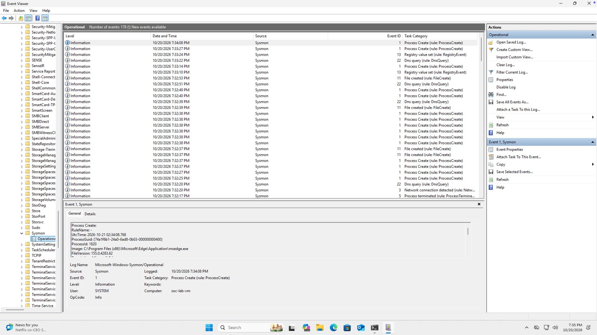

### Sysmon events arriving in Sentinel
`WindowsEvent | where Channel == "Microsoft-Windows-Sysmon/Operational"` returns events from `soc-lab-vm`.

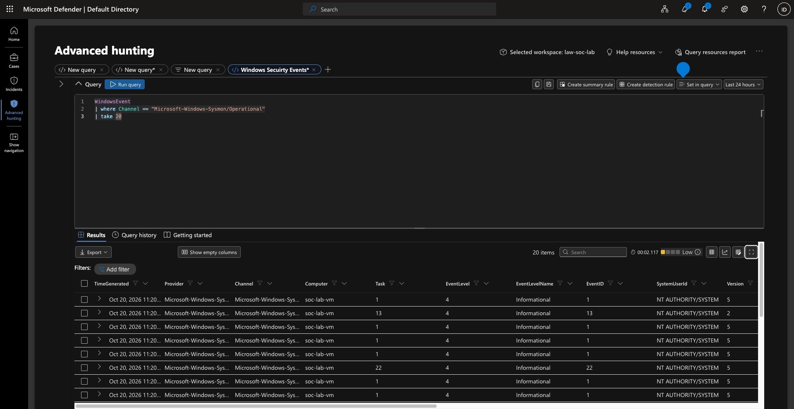
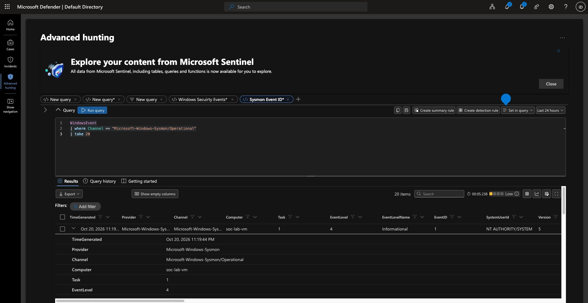

### Sysmon event types collected
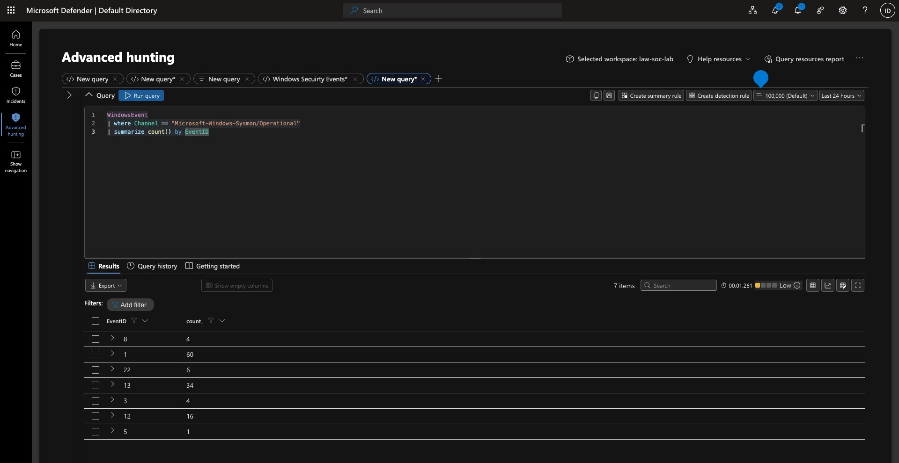

| Sysmon Event ID | Meaning | Count |
|---|---|---|
| 1 | Process creation | 60 |
| 13 | Registry value set | 34 |
| 12 | Registry key created or deleted | 16 |
| 22 | DNS query | 6 |
| 3 | Network connection | 4 |
| 8 | CreateRemoteThread | 4 |
| 5 | Process terminated | 1 |

### Process creation (Sysmon Event ID 1)
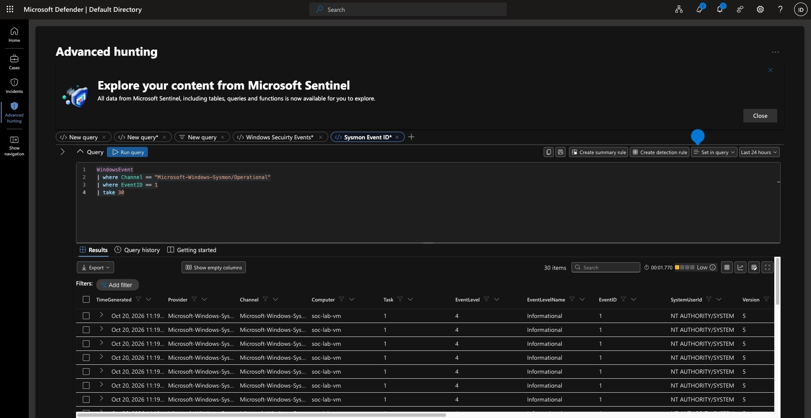

### Windows Security events arriving in Sentinel
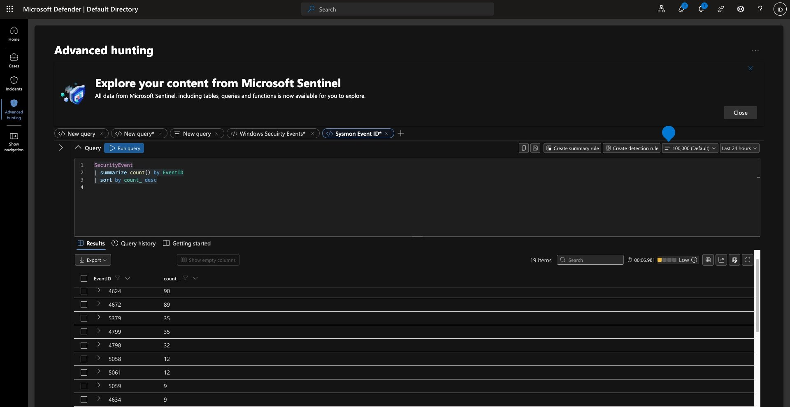

| Event ID | Meaning | Count (last 24h) |
|---|---|---|
| 4624 | Successful logon | 90 |
| 4672 | Special privileges assigned to a new logon | 89 |
| 5379 | Credential Manager credentials read | 35 |
| 4799 | Security-enabled local group membership enumerated | 35 |
| 4798 | A user's local group membership enumerated | 32 |
| 5058 / 5061 / 5059 | Key file and cryptographic operations | 12 / 12 / 9 |
| 4634 | Logoff | 9 |

An earlier run of the same query, shortly after the connector was set up, is in [`screenshots/07-security-events-by-id-first-check.jpg`](screenshots/07-security-events-by-id-first-check.jpg).

### Failed logons (Event ID 4625)
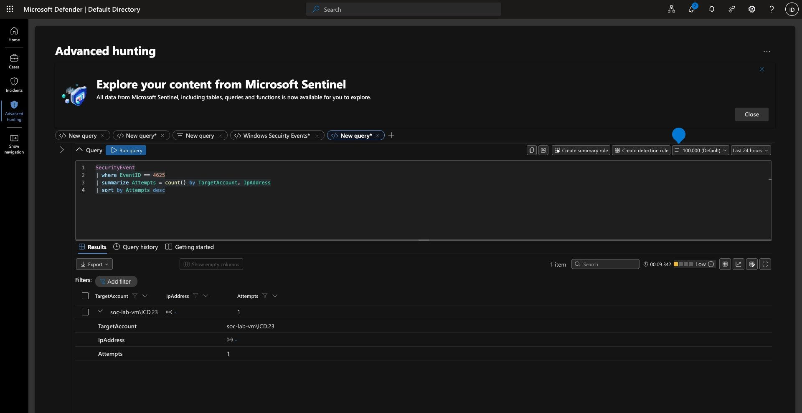

**Finding:** one failed logon for `soc-lab-vm\ICD.23` with no remote source IP. That points to a local mistyped password, not an attack. Because RDP is limited to my own IP, there's no internet brute-force noise, which shows the NSG rule is doing its job.

### Test activity on the VM
I ran `whoami` and `ipconfig /all` on the VM to create activity I could then find in Sysmon process-creation logs (query 6 in [`queries/queries.kql`](queries/queries.kql)).

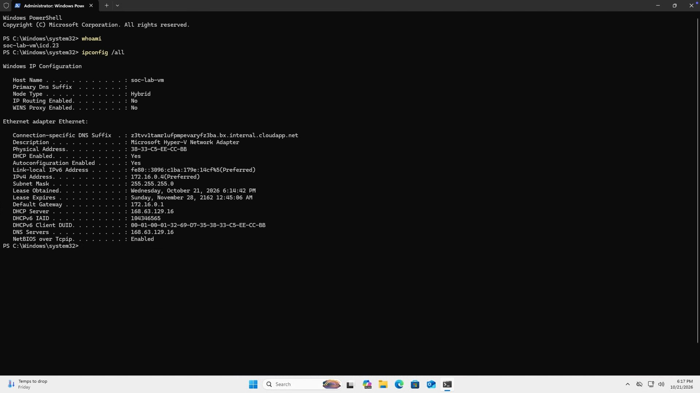

A second run on Oct 21 at about 6:41 PM: `whoami` returns `soc-lab-vm\icd.23`, and `ipconfig /all` shows host `soc-lab-vm` on the Azure private network (172.16.0.4).

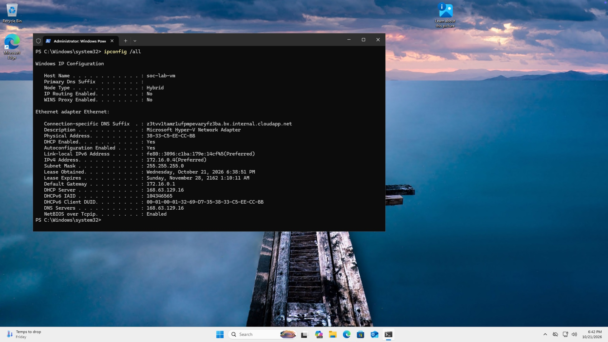
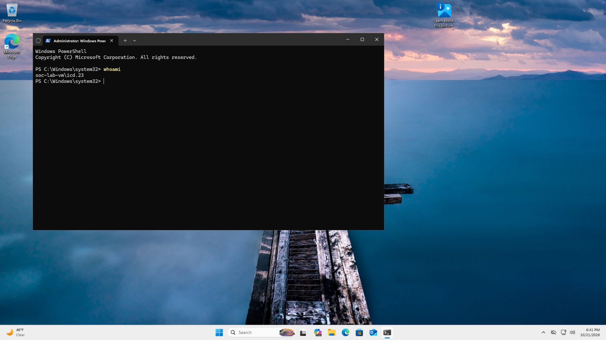

### Traced my own activity in Sentinel
Running `whoami` and `ipconfig /all` is only half the exercise. The other half is finding them from the SIEM side, without looking at the machine. Query 6 filters Sysmon process-creation events (ID 1) for those commands. It returned 3 events from `soc-lab-vm`, run by `soc-lab-vm\ICD.23`:

- 9:41:56 PM: `"C:\Windows\system32\ipconfig.exe" /all`
- 9:41 PM: `whoami.exe`
- 9:16 PM: the earlier test run

The VM clock is on Pacific time and Sentinel shows Eastern, so 6:41 PM on the VM appears as 9:41 PM. Each command showed up in Sentinel within minutes, with the exact command line and the user who ran it.

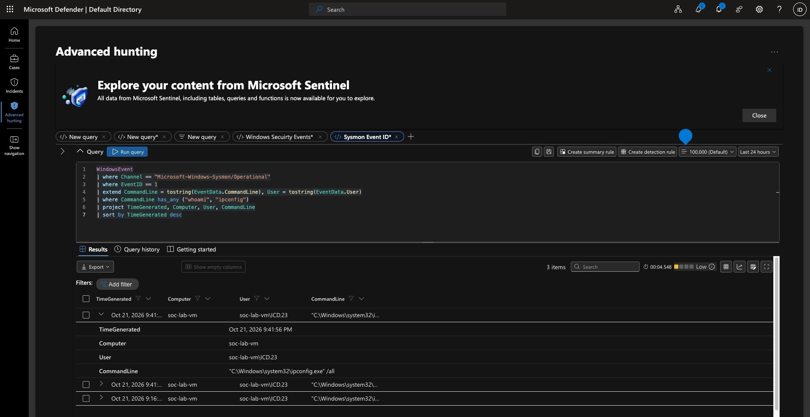

## Queries

The full set is in [`queries/queries.kql`](queries/queries.kql), each with one line on what it proves. The key one traces my own activity:

```kql
WindowsEvent
| where Channel == "Microsoft-Windows-Sysmon/Operational"
| where EventID == 1
| extend CommandLine = tostring(EventData.CommandLine), User = tostring(EventData.User)
| where CommandLine has_any ("whoami", "ipconfig")
| project TimeGenerated, Computer, User, CommandLine
| sort by TimeGenerated desc
```

## What I learned

- **Windows logging is thin by default.** Sysmon adds the process, registry, network and DNS detail needed to reconstruct what happened.
- **The current agent setup** is the Azure Monitor Agent with data collection rules. The old Log Analytics agent is retired.
- **Network controls show up in the logs.** Scoping RDP to my IP is why the failed-logon query is nearly empty.
- **Sentinel also runs in the Defender portal**, where Logs is called Advanced hunting. The KQL is the same.

## What I'd do next

- [ ] Build a brute-force analytics rule on Event ID 4625 and let it fire
- [ ] Work the incident like a Tier 1 analyst: assign it, investigate, write notes, close it with a classification
- [ ] Generate and detect a new local admin account and an encoded PowerShell command
- [ ] Map each detection to MITRE ATT&CK (T1110 Brute Force, T1136 Create Account, T1059.001 PowerShell)
- [ ] Record a five-minute walkthrough and link it at the top of this README

## Cost and cleanup

Between sessions the VM is stopped (deallocated), so it isn't billed for compute. When the lab is finished, deleting `rg-soc-lab` removes every resource in one step.

---
*Built following the MyFirstHack Sentinel SOC Home Lab guide.*
